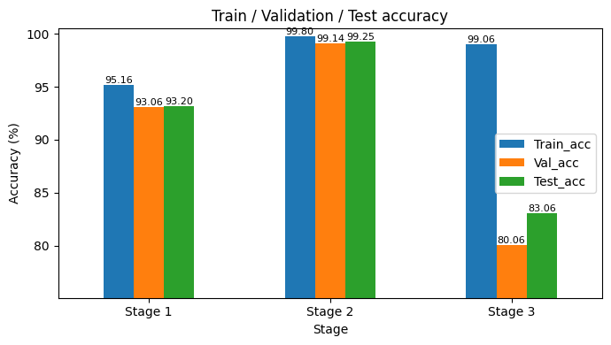
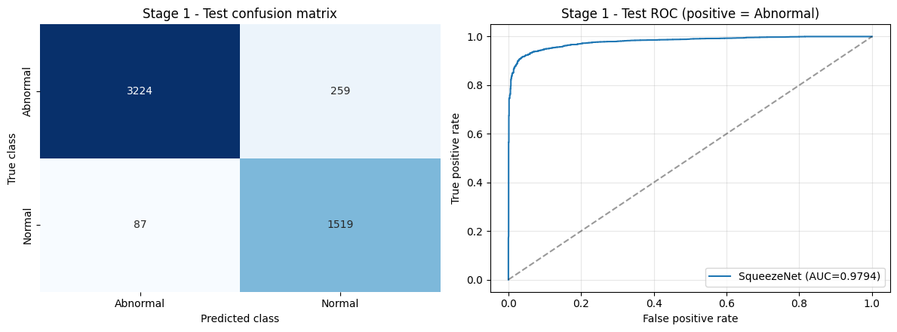
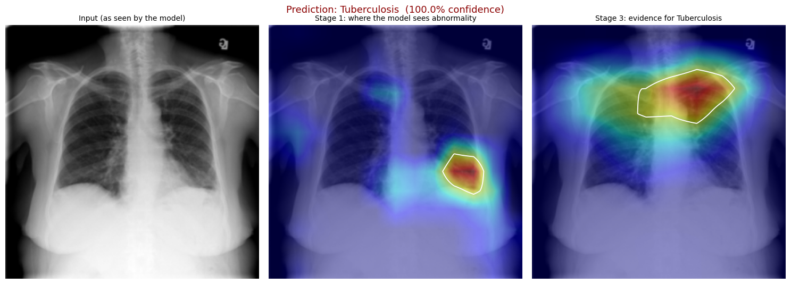
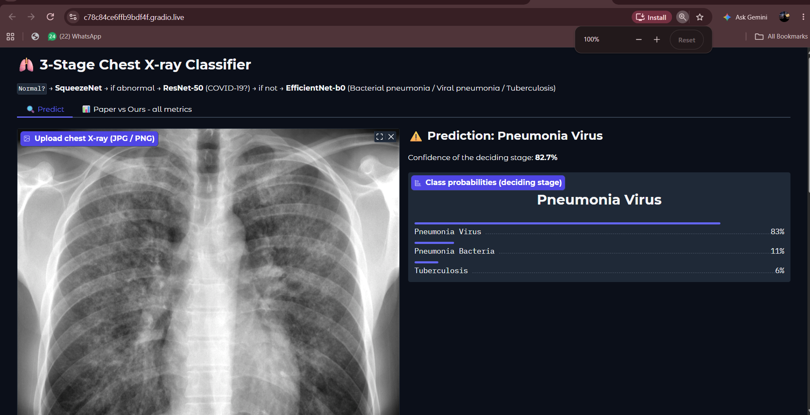
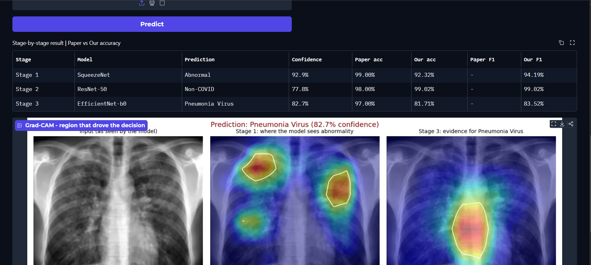

# 🩻 3-Stage Chest X-ray Diagnosis Pipeline

A deep-learning pipeline that takes a chest X-ray and predicts
**Normal / COVID-19 / Bacterial Pneumonia / Viral Pneumonia / Tuberculosis**,
with Grad-CAM heatmaps showing which region drove the decision.

## 🔍 How it works

| Stage | Task | Model |
|---|---|---|
| 1 | Normal vs Abnormal | SqueezeNet |
| 2 | COVID-19 vs Non-COVID | ResNet-50 |
| 3 | Bacterial Pneumonia / Viral Pneumonia / Tuberculosis | EfficientNet-b0 |

`X-ray → Stage 1 → (if Abnormal) Stage 2 → (if Non-COVID) Stage 3`

## ✨ Features
- Transfer learning with ImageNet-pretrained models
- 70 / 15 / 15 train / validation / test split (test set never used for training or model selection)
- **Patient-level split** in Stage 3 to prevent data leakage
- Data augmentation, dropout, early stopping, LR scheduling
- Grad-CAM heatmaps and feature-map visualisation for explainability
- Gradio web app: upload an X-ray → prediction + heatmap + Paper-vs-Ours metrics

## 📊 Results (test set)

| Stage | Model | Train Acc | Val Acc | Test Acc | F1 | AUC |
|---|---|---|---|---|---|---|
| 1 | SqueezeNet | 95.16% | 93.06% | 93.20% | 0.949 | 0.979 |
| 2 | ResNet-50 | 99.80% | 99.14% | 99.25% | 0.992 | 0.9998 |
| 3 | EfficientNet-b0 | 99.06% | 80.06% | 83.06% | 0.859 (macro) | 0.939 |

Stage 3 is the hardest task: Tuberculosis is separated perfectly (F1 = 1.00), but
**bacterial vs viral pneumonia** is difficult (about 80% accuracy) and the model overfits
the small dataset. Improving this is the main future work.

## 🔥 Explainability (Grad-CAM)

## 🖥️ Web App Demo

## 🚀 How to run
1. Open `notebooks/01_training_pipeline.ipynb` in Google Colab
2. Runtime → Change runtime type → **GPU (T4)**
3. Add your own Kaggle API token in Colab Secrets as `KAGGLE_API_TOKEN` (or paste when asked)
4. Run all cells to train the 3 models (weights are saved in `results/`)
5. Open `notebooks/02_gradio_web_app.ipynb` and run it to launch the website

> Trained `.pt` weights are not stored in this repo because of their size.
> Re-train using the notebook, or download them from the Releases page (add link here).

## 📦 Datasets
- [COVID-QU-Ex](https://www.kaggle.com/datasets/anasmohammedtahir/covidqu)
- [TB Chest X-ray](https://www.kaggle.com/datasets/tawsifurrahman/tuberculosis-tb-chest-xray-dataset)
- [Chest X-Ray Images (Pneumonia)](https://www.kaggle.com/datasets/paultimothymooney/chest-xray-pneumonia)

## 🛠️ Tech stack
Python, PyTorch, torchvision, scikit-learn, Pandas, Matplotlib, Seaborn, Gradio, Google Colab

## ⚠️ Disclaimer
Academic mini project. **Not** a medical device and must not be used for real diagnosis.

## 👤 Author
**Nithishsaran R** · [LinkedIn](https://www.linkedin.com/in/nithishsaran-r-9ab540318) · nithishsaranraj20@gmail.com
